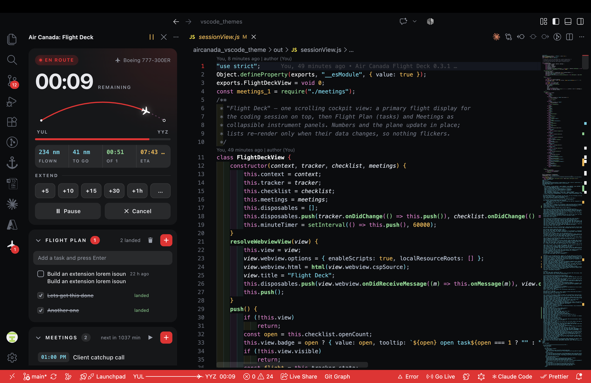
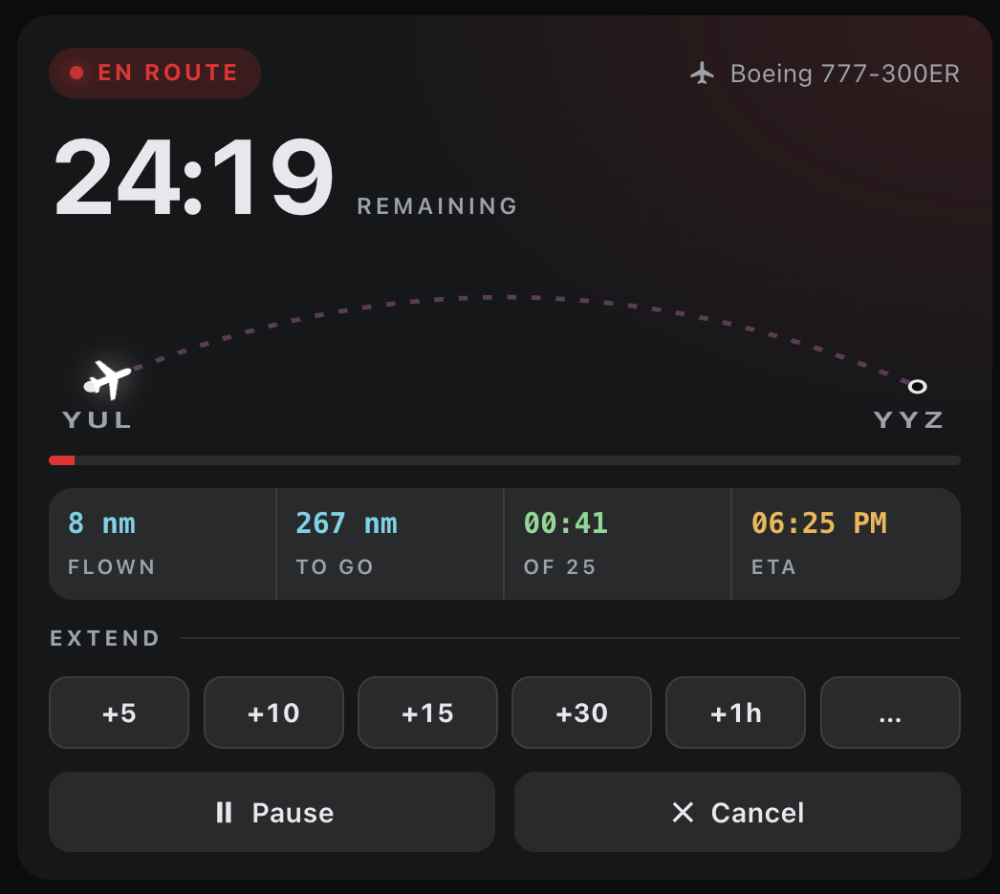
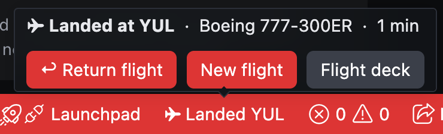
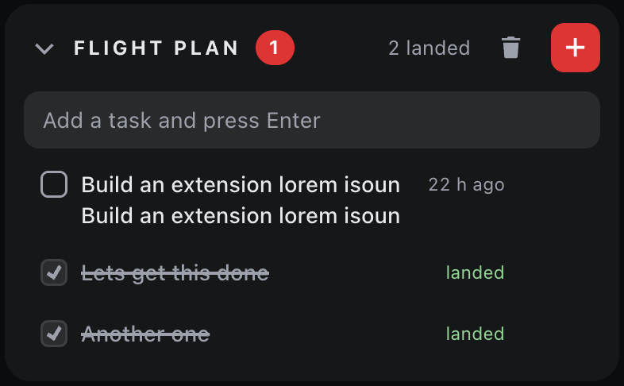
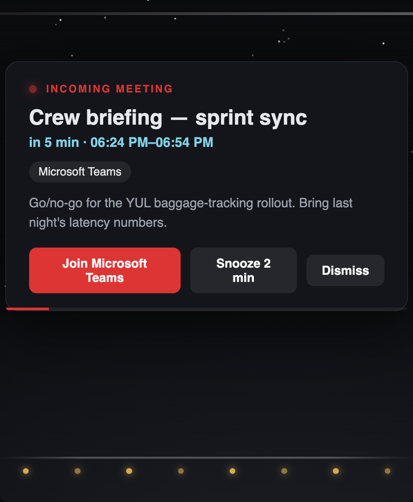
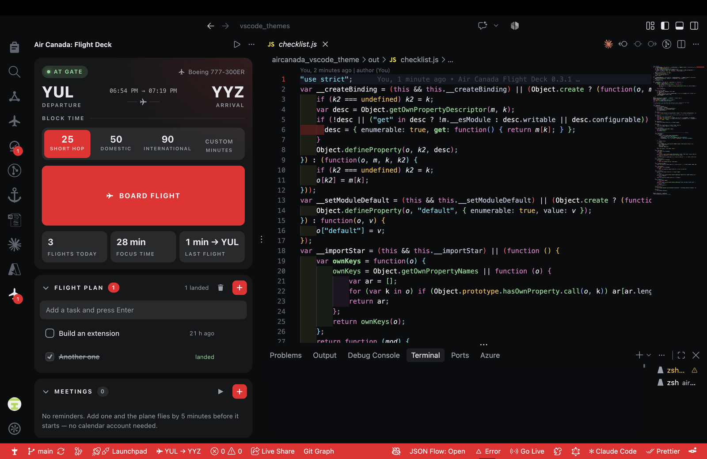

<div align="center">


# Air Canada Flight Deck

**Your editor, cleared for takeoff.**

Colour themes in the 2017 livery · aviation icons · a focus timer that flies · a flight plan for your tasks · meeting reminders that arrive by plane

[](https://marketplace.visualstudio.com/items?itemName=MHuzaifa.air-canada-flight-deck-theme)
[](https://marketplace.visualstudio.com/items?itemName=MHuzaifa.air-canada-flight-deck-theme)

**[✈ Get it on the Marketplace](https://marketplace.visualstudio.com/items?itemName=MHuzaifa.air-canada-flight-deck-theme)** · [⬇ Download the .vsix](https://github.com/MHUZAIFA/aircanada_vscode_theme/raw/main/releases/air-canada-flight-deck-theme.vsix) · [Boarding instructions](#-boarding-install) · [What's on board](#-whats-on-board)



</div>

> 🎙️ *"Good morning, this is your captain speaking. Welcome aboard Flight Deck, service from **"it works on my machine"** to **production**. Our flight time today is 25 minutes. Please stow your notifications, fasten your seatbelt, and enjoy the focus."*

> **Not an official Air Canada product.** This is an employee-made extension for internal use. The extension icon is the official Air Canada Rondelle, taken from the public 2017 logo file, and the palette is sampled from the same file. See [Trademarks](#%EF%B8%8F-trademarks) before distributing it outside the company.

---

## 🎫 Boarding pass

| | |
| --- | --- |
| **Passenger** | You, and your code |
| **Flight** | AC-VSC 031 |
| **Aircraft** | Boeing 777-300ER (or 15 other types, your pick) |
| **From** | Your backlog |
| **To** | Done |
| **Gate** | The activity bar ✈ |
| **Seat** | 1A, by the minimap |
| **Boarding group** | Everyone. Priority boarding for people with failing tests |

---

## 🧳 Boarding (install)

### Fast track: the VS Code Marketplace

1. **Open the Extensions view** in VS Code: `Cmd+Shift+X` on macOS, `Ctrl+Shift+X` on Windows and Linux.
2. **Search** for **Air Canada Flight Deck** and click **Install**. You can also click **Install** on the [Marketplace page](https://marketplace.visualstudio.com/items?itemName=MHuzaifa.air-canada-flight-deck-theme).
3. **Choose your cabin:** **Preferences: Color Theme** (`Cmd/Ctrl+K`, then `Cmd/Ctrl+T`), then *Air Canada Flight Deck*, *Signature Light* or *Rouge*.
4. **Optional upgrade:** **Preferences: File Icon Theme** and **Preferences: Product Icon Theme**, then *Air Canada Aviation*.

Prefer the jet bridge? One command does it:

```bash
code --install-extension MHuzaifa.air-canada-flight-deck-theme
```

Marketplace installs update themselves whenever a new version is published.

### Standby: download the .vsix from GitHub

For machines that can't reach the Marketplace.

1. **Download** [air-canada-flight-deck-theme.vsix](https://github.com/MHUZAIFA/aircanada_vscode_theme/raw/main/releases/air-canada-flight-deck-theme.vsix). You can also open the [`releases`](releases) folder and click **Download raw file**.
2. **Open the Extensions view**, click the **`···`** menu at the top and choose **Install from VSIX…**
3. **Pick the file** you downloaded. VS Code says *Completed installing extension* when you're on board.
4. **Reload:** run **Developer: Reload Window** from the Command Palette (`Cmd/Ctrl+Shift+P`).
5. **Choose your cabin** and icons as in steps 3 and 4 above.

To update a .vsix install, download the file again and repeat steps 2 to 4.

**Deplaning:** Extensions view, then *Air Canada Flight Deck*, then **Uninstall**. No hard feelings.

---

## 🛫 What's on board

### The Flight Deck

Click the ✈ in the activity bar to open the Flight Deck: one scrolling cockpit with your flight on top, and two collapsible panels below it, **Flight Plan** and **Meetings**.

#### At the gate


- **Route.** Click **Departure** or **Arrival** to change just that airport code.
- **Schedule.** Between the airports you see the departure time (now) and estimated arrival for the block you've picked. It updates live as you change your mind.
- **Block time.** **25** Short hop · **50** Domestic · **90** International · **Custom** minutes.
- **Board flight** and you're off.
- **Logbook.** Today's flights, total focus time and where your last flight landed.

<br clear="right" />

#### En route



- **Big clock.** Time remaining, readable from row 40.
- **The route.** The plane flies an arc from origin to destination, with the flown leg in red.
- **Instruments.** Nautical miles flown and to go, elapsed of block, and your ETA.
- **Holding pattern?** Extend with **+5 +10 +15 +30 +1 h** or a custom amount.
- **Pause** for coffee, **Cancel** if the weather turns.

Only the numbers and the plane move each second, so the cockpit never flickers.

<br clear="right" />

#### Landed

Wheels down. You get the destination, your block length, today's totals, and two buttons: **Return flight** swaps the route for the trip home, **New flight** gets you back in the air.

### 📟 Status bar

The flight follows you everywhere in the status bar:

```text
YUL ───✈······ YYZ  01:29
```



- **Hover** for a quick-action card. At the gate you can board 25, 50, 90 or a custom block. In flight you get the extend chips, **Pause / Resume** and **Cancel**. After landing you get **Return flight** and **New flight**.
- **Click** to open the Flight Deck.
- Hover feeling sluggish? Lower `workbench.hover.delay`. 150 ms feels instant.

### 📋 Flight Plan (tasks)



A lightweight to-do list for each workspace.

- **Add** a task in the box and press Enter.
- **Rename** a task by clicking its text. Hover for edit and remove.
- **Land it** with the checkbox. It turns muted grey, is struck through, is marked *landed* in green and moves below the open ones.
- **Badges** on the activity bar and the panel count open tasks.
- **Clear landed** removes finished tasks. **Clear Flight Plan** in the view menu empties the list. Both ask first.

Tasks live in VS Code's workspace storage, never in your repository.

### 📅 Meetings (arriving by plane)

Reminders you type in yourself. There's deliberately **no calendar sync** and no sign-in. Nothing leaves your machine.

**+ Add meeting** asks four things:
- the title
- the time, like `14:30`, `2:30pm`, `in 20`, `+45` or `tomorrow 09:00`
- the length in minutes
- an optional Teams, Zoom or Meet link, or a note

**Five minutes before** it starts, four things happen at once.


1. **Incoming card.** It appears at the top of the Meetings panel, with a red plane flying a straight track while the card is up. The card has the title, time, platform, your note and **Join**, **Snooze 2 min** and **Dismiss**. It closes itself after 20 seconds.
2. **Notification.** A VS Code notification pops up bottom right with **Join** and **Snooze 2 min**.
3. **Fly-by.** A panel opens beside the editor with a night sky and runway lights. An airliner in the 2017 livery tows your meeting card across it.
4. **Taxiing plane.** A ✈ taxis across the status bar with a one-line summary. Click it to join.

<br clear="right" />



- **Preview** a reminder with its play button, or press play in the panel header for a demo meeting. A preview shows the incoming card and the notification without the full fly-by.
- **Edit** a reminder by clicking it. Hover for Join, Preview and Remove.
- **Clear past** tidies up. Reminders older than 12 hours are cleared automatically.

<br clear="right" />

### 📢 Cabin announcements

| When | You'll hear |
| --- | --- |
| Workspace opens | *✈ Boarding complete. Welcome aboard. Flight `main` is ready for departure.* |
| A task succeeds | *✈ Wheels up. "build" completed* |
| A task fails | *✈ Go-around. "test" exited with code 1*, with **Show Problems** and **Show Terminal** |
| Debugging starts or stops | *✈ Cleared for takeoff* / *✈ Landed* |

---

## 🎨 The livery (colour themes)



| Theme | Cabin | Inspired by |
| --- | --- | --- |
| **Air Canada Flight Deck** | Dark | A night cockpit. Black activity bar, near-black editor, Rondelle-red status bar. |
| **Air Canada Signature Light** | Light | The white upper fuselage and black tail. Red accents, black status bar. |
| **Air Canada Rouge** | Dark | The Rouge sub-brand. Burgundy base, bright Rouge red accents. |

### Paint shop

Every hex value is sampled from the official public logo files (Wikimedia Commons: *Air Canada 2017.svg*, *Air Canada Rouge logo.svg*), not from palette sites.

| Role | Hex | Source |
| --- | --- | --- |
| Air Canada red | `#F01428` | Rondelle fill, 2017 logo |
| Charcoal | `#2E2A25` | "AIR CANADA" wordmark, 2017 logo |
| Black | `#000000` | Tail, underbelly, engine nacelles |
| White | `#FFFFFF` | Upper fuselage |
| Rouge burgundy | `#A20B31` | "rouge" script, Rouge logo |
| Rouge red | `#ED1C24` | "AIR CANADA" and Rondelle, Rouge logo |

### Read your code like a flight display

Cockpit displays use a fixed colour language, so a glance tells a pilot what a symbol *means*. The syntax colours speak the same language.

| On the flight display | Colour | In your editor |
| --- | --- | --- |
| **Magenta**, the planned route | `#E07AC8` | Keywords, control flow, decorators |
| **Cyan**, live data and sky | `#5FD3E8` | Strings, regex, links |
| **Green**, engaged, good to go | `#7FD88F` | Functions, methods, git additions |
| **Amber**, caution | `#F2B544` | Numbers, constants, warnings, modified files |
| **Red**, warning and the Rondelle | `#F01428` | Errors, HTML tags, accents, cursor |
| **White**, armed | `#F3F4F6` | Types, classes, headings |

More cockpit touches:

- **Bracket pairs** cycle red, amber, cyan, magenta, green and blue, like approach lighting.
- **The active line number** glows Rondelle red, like the heading bug on a compass display.
- **The git gutter** uses green for added, amber for modified and red for deleted, the same order as cockpit alerts.
- **Terminal colours** follow the same palette, so test runners and CI logs read the same way.

---

## 🛩️ Aviation icons

Two optional icon sets that work with any colour theme.

**Product icons, "Air Canada Aviation."** Pick them with *Preferences: Product Icon Theme*.

| Workbench | Becomes |
| --- | --- |
| Explorer | Luggage tag |
| Search | Radar sweep |
| Source Control | Air-route network |
| Run & Debug | Airliner |
| Extensions | Cockpit gauge |
| Accounts | Pilot wings |
| Settings | Turbine |
| Remote | Control tower |
| Terminal | Runway |
| Notifications | Fasten-seatbelt sign |

**File icons, "Air Canada Aviation (Boarding Pass)."** Pick them with *Preferences: File Icon Theme*. Every file is a boarding pass with a stub coloured by language and an airline-style code like `TS`, `PY`, `MD`, `JSON` or `DKR`. Folders are hangars whose doors open when expanded, and the workspace root is a control tower. It covers 37 languages, 89 file extensions and 50 special file names.

---

## ✅ Pre-flight checklist

New to the fleet? Open **Help → Get Started → Pre-flight checklist**, or run *Air Canada: Open Pre-flight Checklist*. It walks you through the theme, the icons, recommended settings and your first flight.

Recommended settings for the full experience:

```jsonc
{
  "editor.bracketPairColorization.enabled": true,
  "editor.guides.bracketPairs": "active",
  "editor.semanticHighlighting.enabled": true,
  "workbench.colorTheme": "Air Canada Flight Deck"
}
```

---

## 🎛️ Cockpit settings

| Setting | Default | What it does |
| --- | --- | --- |
| `airCanada.flight.enabled` | `true` | Show the flight timer |
| `airCanada.flight.durationMinutes` | `50` | Default block time, 1 to 600 minutes |
| `airCanada.flight.origin` / `destination` | `YYZ` / `YVR` | Airport codes |
| `airCanada.flight.autoStart` | `false` | Board automatically when VS Code starts |
| `airCanada.flight.aircraft` | `Boeing 777-300ER` | Aircraft shown on the deck and hover |
| `airCanada.meetings.leadMinutes` | `5` | Minutes of warning before a meeting |
| `airCanada.meetings.flyby.enabled` | `true` | The fly-by panel |
| `airCanada.meetings.flyby.durationSeconds` | `20` | How long the fly-by and the incoming card stay up |
| `airCanada.meetings.statusBarFlyby` | `true` | The taxiing plane in the status bar |
| `airCanada.meetings.notification` | `true` | The notification with Join and Snooze |
| `airCanada.notifications.enabled` | `true` | All cabin announcements. Fine-tune with `.welcome`, `.tasks` and `.debug` |

**Hangar of aircraft types:** Boeing 777-300ER, 777-200LR, 787-8, 787-9, 747-400, 737 MAX 8, Airbus A220-300, A320, A321, A321neo, A330-300, A350-1000, A380, Embraer E175, CRJ900 and Dash 8-400.

---

## 🔧 Maintenance hangar (for developers)

### Build from source

```bash
git clone https://github.com/MHUZAIFA/aircanada_vscode_theme.git
cd aircanada_vscode_theme
npm install
npm run build        # themes + file icons + product icon font + TypeScript
npm run package      # produces a .vsix in the project folder
```

Or press `F5` with the folder open in VS Code to fly a test aircraft in an Extension Development Host.

### Ship a new version

1. Bump `version` in `package.json` and add a `CHANGELOG.md` entry. The Marketplace rejects a version number it already has.
2. Run `npm run release`. It builds everything and writes `releases/air-canada-flight-deck-theme.vsix`.
3. **Marketplace:** on the [publisher page](https://marketplace.visualstudio.com/manage/publishers/mhuzaifa), open the **⋯** menu next to the extension, choose **Update** and upload that file. With an access token set up, `npx vsce publish` does the same from the terminal.
4. **GitHub:** commit and push. The download link at the top always serves the newest file, and the README's screenshots load from the repository.

### Repaint the fleet

All three colour themes are generated from one file, `scripts/build-themes.js`. Change a hex in its `variants` block and run `npm run build`. Don't edit `themes/*.json`, `icons/**/*.json` or `icons/**/svg/*` by hand, because they're build output.

### Aircraft layout

```text
aircanada_vscode_theme/
├── package.json                    # manifest: themes, icon themes, commands, settings, walkthrough
├── src/
│   ├── extension.ts                # activate(): commands + wiring
│   ├── flightTracker.ts            # status-bar coding-session timer (the flight)
│   ├── sessionView.ts              # Flight Deck webview: flight card, Flight Plan, Meetings
│   ├── checklist.ts                # task checklist store + prompts
│   ├── meetings.ts                 # meeting reminders, scheduler, incoming card + notification
│   ├── flyby.ts                    # animated fly-by panel + status-bar plane
│   ├── notifications.ts            # boarding / wheels-up / go-around / debug announcements
│   └── git.ts                      # current branch via built-in Git API
├── scripts/
│   ├── build-themes.js             # single source of truth for colours → themes/*.json
│   ├── build-file-icons.js         # boarding-pass table → icons/files/svg + theme JSON
│   └── build-product-icons.js      # glyph SVGs → icons/product/dist/*.woff + theme JSON
├── themes/                         # generated: three colour themes
├── icons/files/                    # generated: file icon theme
├── icons/product/                  # generated: product icon theme (font + JSON)
├── media/walkthrough/              # pre-flight checklist pages
├── images/icon.svg|png             # official Rondelle on black (Air Canada trademark)
├── images/screenshots/             # README screenshots (not packaged)
├── releases/                       # latest .vsix, linked from the top of this README
├── samples/flight-plan.ts          # demo file for screenshots and QA
└── .vscode/launch.json             # F5 → Extension Development Host
```

---

## ⚖️ Trademarks

"Air Canada", "Air Canada Rouge", "Air Canada Signature" and the Rondelle / maple-leaf marks are trademarks of Air Canada. This is an independent, employee-made project for internal use. The extension icon **does** use the official Rondelle, with path geometry from the public 2017 logo file. That file is tagged public domain on Wikimedia Commons for copyright purposes, but trademark rights are unaffected. Get Brand and Legal clearance for the name, colours and logo before distributing the extension outside the company, for example on the VS Code Marketplace.

## 👨‍✈️ Your captain

Created by **MHUZAIFA**

- GitHub: [github.com/MHUZAIFA](https://github.com/MHUZAIFA)
- Portfolio: [mohammedhuzaifa.vercel.app](https://mohammedhuzaifa.vercel.app/)

## 📓 Flight log

See [CHANGELOG.md](CHANGELOG.md).

## 📄 License

MIT. See [LICENSE](LICENSE).

---

<div align="center">

*Thank you for flying Flight Deck. We know you have a choice of editor themes, and we're glad you chose to fly with us.* ✈️

</div>
