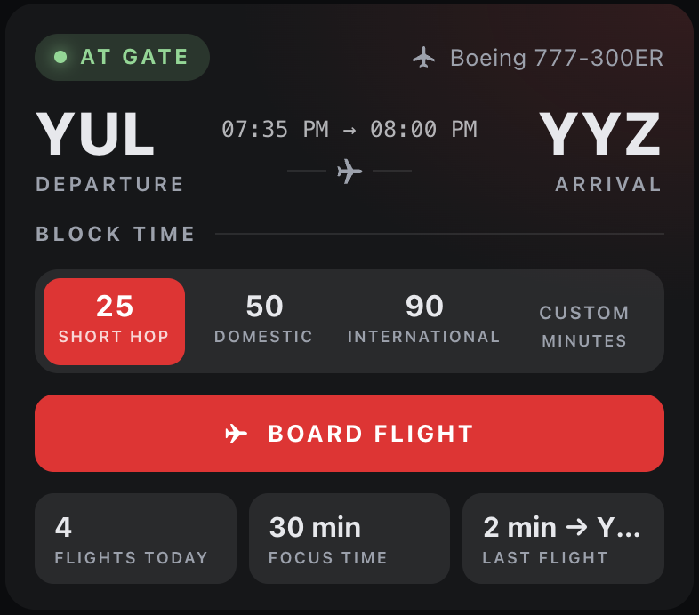
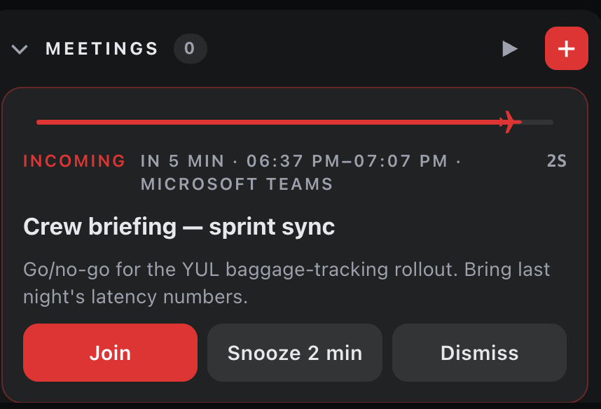
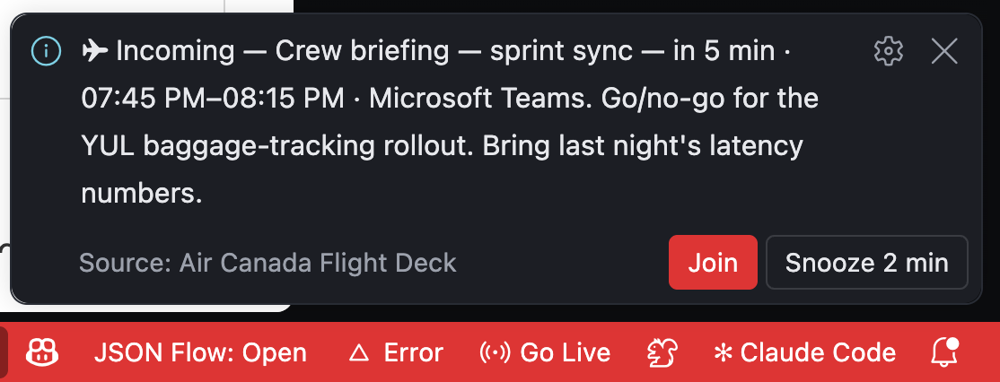
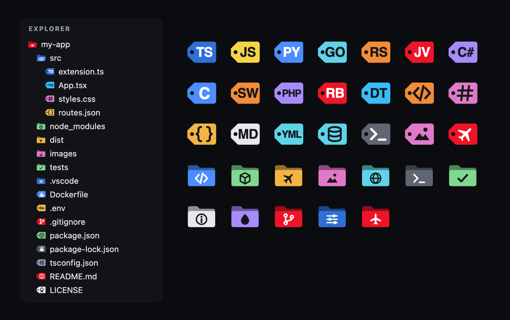

<div align="center">


# Air Canada Flight Deck

**Your editor, cleared for takeoff.**

[](https://marketplace.visualstudio.com/items?itemName=MHuzaifa.air-canada-flight-deck-theme)
[](https://marketplace.visualstudio.com/items?itemName=MHuzaifa.air-canada-flight-deck-theme)

Three colour themes in the 2017 livery · aviation icons · a focus timer that flies · a flight plan for your tasks · meeting reminders that arrive by plane


*"This is your captain speaking. Welcome aboard, service from **it works on my machine** to **production**. Please fasten your seatbelt and enjoy the focus."*

</div>

> Not an official Air Canada product. This is an independent, fan-made extension, not affiliated with or endorsed by Air Canada.

---

## 🧳 Boarding

**From the Marketplace (recommended).** Open the Extensions view (`Cmd/Ctrl+Shift+X`), search for **Air Canada Flight Deck** and click **Install**. Or run:

```bash
code --install-extension MHuzaifa.air-canada-flight-deck-theme
```

**From GitHub.** Download [air-canada-flight-deck-theme.vsix](https://github.com/MHUZAIFA/aircanada_vscode_theme/raw/main/releases/air-canada-flight-deck-theme.vsix). In the Extensions view, open the **`···`** menu, choose **Install from VSIX…**, pick the file, then run **Developer: Reload Window**.

**Then pick your seat:**

- **Colour theme:** *Preferences: Color Theme* → *Air Canada Flight Deck*, *Signature Light* or *Rouge*.
- **Icons (optional):** *Preferences: File Icon Theme* and *Preferences: Product Icon Theme* → *Air Canada Aviation*.
- **Guided tour:** *Help → Get Started → Pre-flight checklist*.

---

## 🛫 The Flight Deck

Click ✈ in the activity bar. Your flight sits on top, with **Flight Plan** and **Meetings** below.

<table>
<tr>
<td width="50%" valign="top">

**At the gate**



- Click **Departure** or **Arrival** to change that airport.
- See now and your estimated arrival before you board.
- Pick a block: **25** Short hop, **50** Domestic, **90** International or custom.

</td>
<td width="50%" valign="top">

**En route**


- The plane flies the arc as your time runs down.
- Distance flown and to go, elapsed time and ETA.
- Extend by **+5** to **+1 h**, **Pause** or **Cancel**.

</td>
</tr>
</table>

**Landed.** Choose **Return flight** to fly the route back, or **New flight**. Today's flights and focus time are logged on the card.

### ✈️ Status bar

```text
YUL ───✈······ YYZ  01:29
```

Your flight follows you in the status bar. Click it to open the Flight Deck, or hover for quick actions: board, extend, pause, cancel or fly home.


### 🎫 Flight Plan


A to-do list for each workspace. Type a task and press Enter, and tick it off when it has *landed*. Long names wrap to three lines, and hovering shows the full name. Tasks stay in VS Code's storage, never in your repository.

### 🛬 Meetings, arriving by plane

Press **+** in the Meetings panel and answer four questions: the title, the time (such as `14:30`, `in 20` or `tomorrow 09:00`), the length, and an optional Teams, Zoom or Meet link or a note. There's no calendar sync or sign-in, and nothing leaves your machine.

<table>
<tr>
<td width="50%" valign="top">



*The incoming card in the Meetings panel*

</td>
<td width="50%" valign="top">



*The VS Code notification*

</td>
</tr>
</table>

Five minutes before it starts:

- **Incoming card.** It appears at the top of Meetings, with **Join**, **Snooze 2 min** and **Dismiss**. A red plane flies the track and the seconds count down until the card closes itself.
- **Notification.** A VS Code notification with **Join** and **Snooze**.
- **Fly-by.** An airliner in the 2017 livery tows your meeting across a night sky beside the editor.
- **Status bar.** A ✈ taxis past with the summary. Click it to join.

**Previewing.** Press the play button on a meeting to preview it, or the one in the Meetings header for a demo meeting. A preview shows the incoming card and the notification, without the fly-by.

### 🧑‍✈️ Cabin announcements

| When | You'll see |
| --- | --- |
| A workspace opens | *Boarding complete. Welcome aboard.* |
| A task succeeds | *Wheels up* |
| A task fails | *Go-around*, with **Show Problems** and **Show Terminal** |
| Debugging starts or ends | *Cleared for takeoff* / *Landed* |

---

## 💺 The livery


| Theme | Inspired by |
| --- | --- |
| **Flight Deck** (dark) | A night cockpit with a Rondelle-red status bar |
| **Signature Light** (light) | The white fuselage and black tail |
| **Rouge** (dark) | Rouge burgundy `#A20B31` with bright red accents |

Syntax colours follow the colour language of cockpit flight displays, so a glance tells you what you're looking at:

| Flight display | Colour | In your code |
| --- | --- | --- |
| Magenta, the planned route | `#E07AC8` | Keywords and control flow |
| Cyan, live data | `#5FD3E8` | Strings and links |
| Green, engaged | `#7FD88F` | Functions and git additions |
| Amber, caution | `#F2B544` | Numbers, constants and warnings |
| Red, warning | `#F01428` | Errors, tags and the cursor |
| White, armed | `#F3F4F6` | Types and classes |

Brand colours are sampled from the official 2017 logo files: Air Canada red `#F01428`, charcoal `#2E2A25`, black and white.

## 🛩️ Aviation icons



**File icons: "Air Canada Aviation (Luggage Tags)".** Pick them with *Preferences: File Icon Theme*.

- **Every file is a luggage tag** in its language's colour, with a bold code of up to three letters, like `TS`, `PY` or `GO`.
- **Symbols replace letters** where they read better at 16px: `{ }` for JSON, a branch for Git, a padlock for lockfiles, a box for `package.json`, a key for `.env` and a plane for `.vsix`.
- **Folders get their own colour and badge**, including `src`, `node_modules`, `.vscode`, `images`, `tests` and `docs`. Build folders like `out` and `dist` carry a departing plane, and the workspace root is Rondelle red.

**Product icons: "Air Canada Aviation".** Pick them with *Preferences: Product Icon Theme*. The workbench gets aviation glyphs: a luggage-tag Explorer, radar Search, route-map Source Control, airliner Run & Debug, control-tower Remote, runway Terminal and a fasten-seatbelt sign for notifications.

---

## 🛂 Settings

| Setting | Default | |
| --- | --- | --- |
| `airCanada.flight.durationMinutes` | `50` | Default block time |
| `airCanada.flight.origin` / `destination` | `YYZ` / `YVR` | Airport codes |
| `airCanada.flight.aircraft` | `Boeing 777-300ER` | One of 16 aircraft types |
| `airCanada.flight.autoStart` | `false` | Board when VS Code starts |
| `airCanada.flight.enabled` | `true` | Show the flight timer |
| `airCanada.meetings.leadMinutes` | `5` | Warning before a meeting |
| `airCanada.meetings.flyby.durationSeconds` | `20` | How long alerts stay up |
| `airCanada.meetings.flyby.enabled` | `true` | Fly-by panel |
| `airCanada.meetings.statusBarFlyby` | `true` | Status-bar plane |
| `airCanada.meetings.notification` | `true` | Meeting notification |
| `airCanada.notifications.enabled` | `true` | Cabin announcements. Fine-tune with `.welcome`, `.tasks` and `.debug` |

---

## 🛩️ Ground crew

```bash
git clone https://github.com/MHUZAIFA/aircanada_vscode_theme.git
cd aircanada_vscode_theme
npm install
npm run build        # themes, icons and TypeScript
```

Press `F5` to try it in an Extension Development Host.

- **Colours** all come from `scripts/build-themes.js`. Edit a hex there and rebuild. Don't edit the generated `themes/` or `icons/` files.
- **Releasing:** bump `version` in `package.json`, add a `CHANGELOG.md` entry and run `npm run release`. Upload `releases/air-canada-flight-deck-theme.vsix` with **Update** on the [Marketplace publisher page](https://marketplace.visualstudio.com/manage/publishers/mhuzaifa), then push to GitHub.

---

<div align="center">

"Air Canada", "Air Canada Rouge", "Air Canada Signature" and the Rondelle are trademarks of Air Canada.

Made by [MHUZAIFA](https://github.com/MHUZAIFA) · [Portfolio](https://mohammedhuzaifa.vercel.app/) · [Changelog](CHANGELOG.md) · [MIT License](LICENSE)

*Thank you for flying Flight Deck. We know you have a choice of themes.* ✈️

</div>
